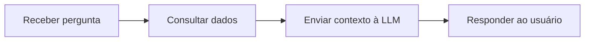
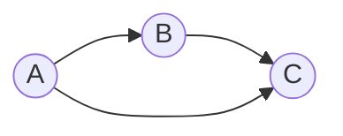
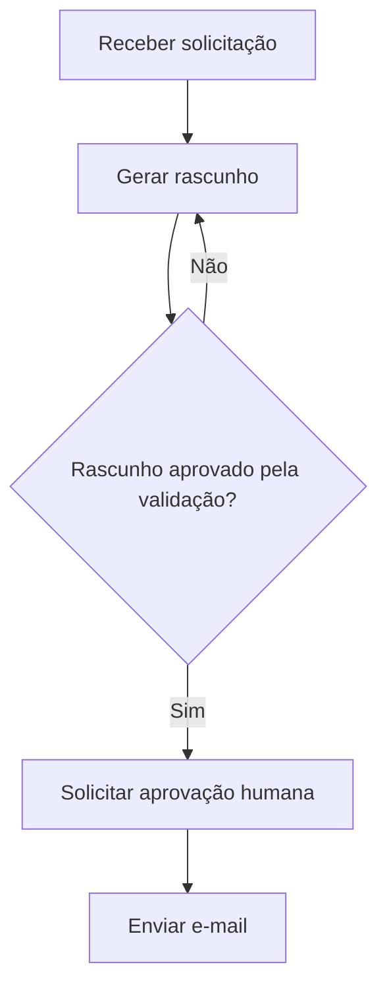
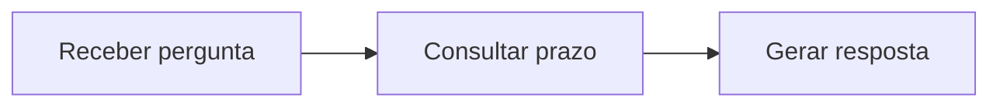
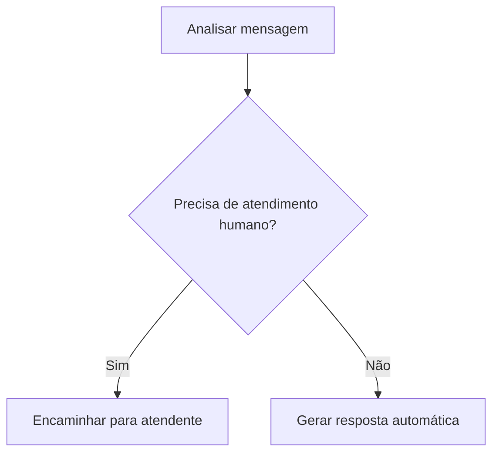
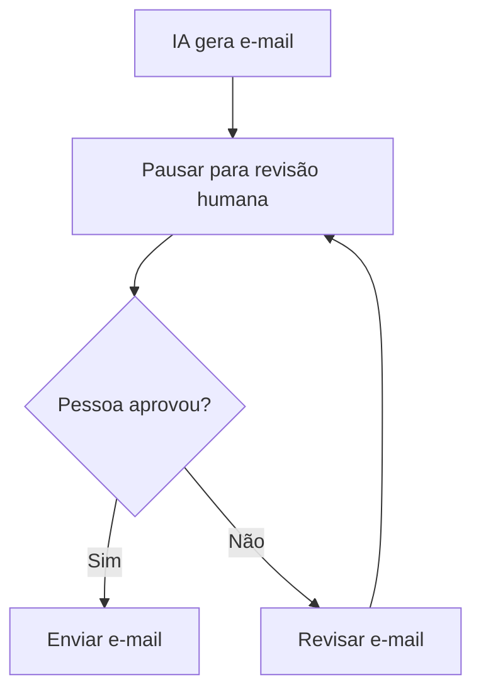
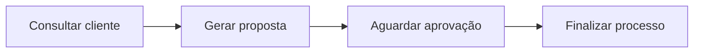
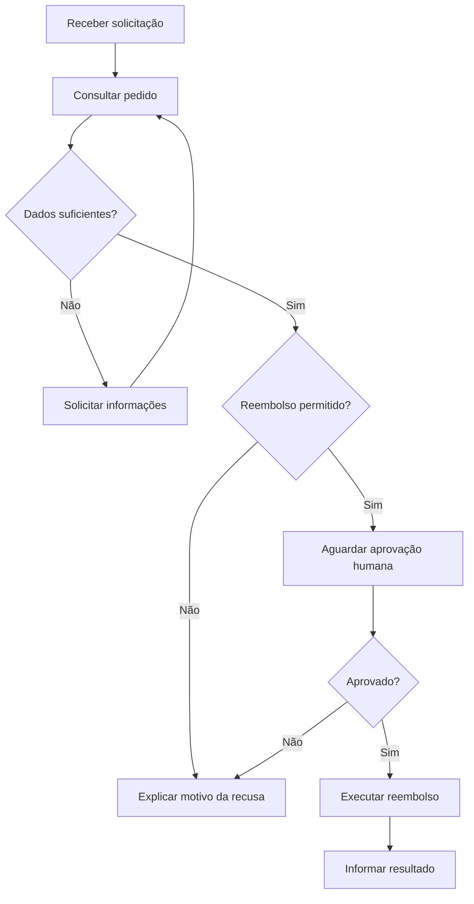

# LangChain vs. LangGraph

## Introdução

Com a popularização das APIs de modelos de inteligência artificial, como as da OpenAI, desenvolvedores passaram a integrar **LLMs (Large Language Models)** às suas aplicações.

Uma LLM consegue receber instruções em linguagem natural e produzir respostas, mas uma aplicação real normalmente precisa de mais do que enviar uma pergunta e receber um texto. Ela pode precisar consultar um banco de dados, buscar documentos, executar funções, chamar APIs ou decidir o que fazer depois de cada resposta.

É nesse cenário que entram o **LangChain** e o **LangGraph**, dois projetos do mesmo ecossistema, com objetivos relacionados, mas diferentes.

- **LangChain:** facilita a integração de modelos de IA com prompts, ferramentas, dados e outros componentes da aplicação.
- **LangGraph:** permite construir e controlar fluxos de execução com estado, decisões, ciclos, pausas e retomadas.

**Uma analogia para quem programa:** o LangChain oferece componentes para trabalhar com IA; o LangGraph ajuda a organizar como esses componentes e outras funções se comportam ao longo de um processo. Eles podem ser utilizados juntos.

> Importante: LangGraph não é simplesmente a versão nova do LangChain. Na arquitetura atual do ecossistema, agentes de alto nível do LangChain já podem utilizar o LangGraph por baixo dos panos.

## 1. LangChain

O **LangChain** é um framework que facilita a criação de aplicações que utilizam modelos de linguagem. Em vez de implementar manualmente todas as integrações, podemos utilizar componentes para criar prompts, conversar com modelos, chamar ferramentas e consultar fontes externas.

Uma das ideias que popularizou o framework é o **encadeamento de operações** (*chains*): a saída de uma etapa pode alimentar a próxima.

Por exemplo, imagine um sistema que recebe a pergunta de um usuário sobre um produto:

1. Recebe a pergunta.
2. Consulta informações do produto em uma API ou banco de dados.
3. Envia essas informações e a pergunta para uma LLM.
4. Retorna uma resposta ao usuário.



Isso se parece com executar funções em sequência:

```php
$pergunta = receberPergunta();
$dados = consultarProduto($pergunta);
$resposta = consultarLLM($pergunta, $dados);
return $resposta;
```

Nesse exemplo, **não precisamos de várias LLMs**. Uma única LLM já pode ser suficiente. Também podemos combinar modelos diferentes, caso isso faça sentido para o problema.

### LangChain é limitado a DAGs?

**Não.** É comum representar uma sequência de operações como um **DAG (Directed Acyclic Graph, ou Grafo Direcionado Acíclico)**, mas isso não significa que toda aplicação com LangChain tenha obrigatoriamente esse formato. O LangChain também oferece agentes que podem decidir chamar ferramentas repetidamente; atualmente, seus agentes de alto nível podem ser executados sobre LangGraph.

Um DAG é um grafo com arestas direcionadas e **sem ciclos**. Isso significa que não é possível seguir as setas e retornar ao nó de onde se partiu.



Repare que **A pode ir diretamente para C**. Portanto, um DAG não obriga a passar pelo nó B. A única restrição é não existir um caminho direcionado que volte ao próprio nó.

**Quando LangChain costuma ser uma boa escolha?** Quando precisamos integrar uma LLM à aplicação, estruturar prompts, chamar ferramentas ou montar um agente sem precisar controlar detalhadamente cada etapa de sua execução.

## 2. LangGraph

O **LangGraph** é uma ferramenta de orquestração de fluxos com estado. Com ele, organizamos um processo em **nós** (*nodes*) e **arestas** (*edges*).

- **Nó:** uma etapa do processo, como uma função que consulta um banco, chama uma LLM ou valida um resultado.
- **Aresta:** uma ligação que define qual etapa pode vir depois de outra.
- **Estado (*state*):** um conjunto de dados compartilhados ao longo da execução.

A principal vantagem é conseguir representar processos que exigem **decisões, repetições e retomadas** de maneira explícita.

Imagine uma IA encarregada de redigir um e-mail. Depois de gerar o texto, o sistema avalia sua qualidade. Se não estiver bom, pede outra versão. Se estiver bom, encaminha para aprovação.



Nesse fluxo, **C pode retornar para B**. Isso forma um ciclo, algo que não seria permitido em um DAG.

Em termos de programação, lembra um `while` ou um `do...while`:

```php
$tentativas = 0;

do {
    $rascunho = gerarRascunho();
    $aprovado = validarRascunho($rascunho);
    $tentativas++;
} while (!$aprovado && $tentativas < 3);
```

No LangGraph, além de permitir essa repetição, conseguimos visualizar e controlar as etapas e os dados utilizados durante o processo.

> Atenção: em um fluxo real, devemos definir limites de tentativas ou condições de saída para evitar loops infinitos.

### 2.1. Stateful Graph — Estado compartilhado

Uma das características centrais do LangGraph é o **estado compartilhado**.

Em uma sequência tradicional de funções, geralmente passamos informações entre etapas por parâmetros e valores de retorno. No LangGraph, podemos definir um objeto de estado contendo os dados que precisam acompanhar a execução.

Por exemplo:

```json
{
  "pergunta": "Qual é o prazo de entrega?",
  "cliente_id": 123,
  "prazo_dias": null,
  "resposta": null,
  "aprovado": false
}
```

Imagine três nós:

- **A:** recebe a pergunta e identifica o cliente.
- **B:** consulta o prazo de entrega no banco de dados e atualiza `prazo_dias`.
- **C:** utiliza `pergunta` e `prazo_dias` para gerar a resposta e atualizar `resposta`.



Cada nó recebe o estado disponível naquele momento e pode **retornar atualizações** para ele. Assim, C consegue ler a pergunta que foi armazenada por A sem precisar receber manualmente essa informação de B como um parâmetro específico.

O estado é parecido com um objeto de contexto compartilhado:

```php
$state = [
    'pergunta' => 'Qual é o prazo de entrega?',
    'cliente_id' => 123,
    'prazo_dias' => null,
    'resposta' => null,
    'aprovado' => false,
];
```

**Importante:** o estado compartilhado **não faz o fluxo pular nós automaticamente**. Ele define como os dados são acessados e atualizados. As arestas e as regras de roteamento definem por onde a execução passa.

Em execuções com ramificações paralelas, também precisamos definir como atualizações simultâneas de determinados campos serão combinadas, utilizando mecanismos como *reducers*.

### 2.2. Conditional Edges — Decisões no fluxo

Além de ligar um nó diretamente ao próximo, o LangGraph permite escolher o caminho a seguir com base nos dados do estado.

Exemplo: após analisar uma mensagem, a aplicação decide se deve responder automaticamente ou solicitar atendimento humano.



Para quem programa, é semelhante a um `if/else`. A diferença é que essas decisões passam a fazer parte da definição explícita do fluxo.

### 2.3. Human-in-the-loop — Participação humana

**Human-in-the-loop** é a possibilidade de interromper a execução para que uma pessoa forneça alguma informação, faça uma escolha ou aprove uma ação.

Por exemplo, podemos permitir que uma IA escreva um e-mail, mas exigir que alguém aprove o texto antes do envio:



A pausa pode ser implementada com recursos como `interrupt()`, e a execução pode ser retomada quando a aplicação receber a decisão humana.

Isso é útil em processos nos quais uma IA **não deve executar ações sensíveis sem autorização**, como aprovar pagamentos, excluir informações ou enviar uma comunicação oficial.

### 2.4. Checkpoints — Salvando o progresso

Um **checkpoint** é um registro do estado de execução em determinado momento. Com um mecanismo de persistência (*checkpointer*) configurado, o LangGraph pode salvar estados para permitir inspeção, recuperação e retomada.

Imagine o seguinte processo:



Se o processo precisar aguardar uma aprovação, os checkpoints ajudam a preservar o contexto necessário para retomá-lo posteriormente.

É parecido com salvar o progresso de uma operação, em vez de precisar recomeçar tudo do zero.

**Atenção:** persistência não significa que todo passo será salvo automaticamente em qualquer configuração. É necessário configurar o checkpointer e considerar as opções de durabilidade. Além disso, retomar um fluxo não desfaz operações já executadas em sistemas externos.

### 2.5. Time Travel — Inspecionando estados anteriores

O **Time Travel** permite acessar checkpoints anteriores e, quando configurado adequadamente, iniciar uma nova execução a partir de um estado histórico, inclusive modificando informações antes da retomada.

Por exemplo:

1. Uma IA recebe uma pergunta.
2. Consulta um documento.
3. Gera uma resposta incorreta.
4. O desenvolvedor inspeciona o estado salvo antes da geração da resposta.
5. A execução pode ser retomada a partir desse ponto para investigar ou testar outro resultado.

Isso é especialmente útil para **debug**, testes e análise do comportamento da aplicação.

Pense nele como a capacidade de recuperar um *snapshot* do fluxo. Porém, **não é um `git revert` do mundo real**: se um nó já enviou um e-mail ou realizou um pagamento, voltar ao estado anterior não desfaz automaticamente essas ações.

## 3. Principais diferenças

| Característica | LangChain | LangGraph |
|---|---|---|
| Principal objetivo | Integrar modelos, ferramentas e dados | Orquestrar fluxos com controle explícito |
| Uso típico | Chatbots, RAG, agentes e integrações com LLMs | Agentes e processos com múltiplas etapas, decisões e ciclos |
| Fluxo de execução | Abstrações de alto nível; pode usar LangGraph internamente | Nós, arestas, condições e ciclos definidos explicitamente |
| Estado | Pode trabalhar com histórico e memória, inclusive via LangGraph | Estado compartilhado e atualizações entre nós |
| Pausas e retomadas | Disponíveis conforme a arquitetura e o agente utilizado | Suporte direto com interrupções e persistência configurada |
| Complexidade | Geralmente mais simples para começar | Mais controle, com maior responsabilidade de implementação |

## 4. Exemplo prático: atendimento ao cliente

Imagine que estamos desenvolvendo um sistema de suporte:

**Cenário simples:** o usuário pergunta sobre o horário de funcionamento. A aplicação consulta uma informação e a LLM responde. O LangChain oferece os componentes necessários para resolver isso de forma direta.

**Cenário complexo:** o usuário solicita um reembolso. Agora precisamos:

1. Identificar a intenção do usuário.
2. Consultar o pedido no banco de dados.
3. Verificar se o reembolso é permitido.
4. Solicitar mais informações quando necessário.
5. Pedir autorização humana, se exigida.
6. Executar o reembolso somente após as validações.
7. Informar o resultado ao usuário.



Esse segundo cenário é um bom candidato ao **LangGraph** porque possui condições, retorno a etapas anteriores, estado compartilhado e intervenção humana. Podemos continuar utilizando componentes do **LangChain dentro dos nós** para conversar com a LLM e acessar ferramentas.

## 5. Afinal, qual devo utilizar?

**Comece com LangChain** quando precisar integrar uma LLM, criar prompts, consultar documentos ou construir rapidamente um agente utilizando abstrações prontas.

**Considere LangGraph** quando precisar controlar cuidadosamente o processo: criar ciclos, dividir responsabilidades entre nós, preservar estado, aguardar humanos ou recuperar execuções.

Não é necessário escolher apenas um. Uma aplicação pode utilizar **LangChain para interagir com modelos e ferramentas** e **LangGraph para controlar o fluxo de execução**.

**Resumo em uma frase:** o LangChain ajuda a construir as funcionalidades de uma aplicação com IA; o LangGraph ajuda a coordenar quando, como e em qual sequência essas funcionalidades são executadas.

## Glossário

**LLM (Large Language Model / Grande Modelo de Linguagem):** modelo de IA treinado em grandes volumes de dados, capaz de interpretar e gerar linguagem e, dependendo do modelo, realizar outras tarefas. Exemplos: modelos GPT, Claude e Llama.

**Prompt:** instrução ou conjunto de informações enviadas para orientar a resposta de um modelo.

**Chain:** composição de operações, na qual dados ou resultados de uma etapa são utilizados por outras etapas.

**DAG (Directed Acyclic Graph / Grafo Direcionado Acíclico):** grafo composto de nós e arestas direcionadas, sem ciclos direcionados. Pode ter ramificações e caminhos alternativos; não precisa ser uma sequência linear.

**Grafo com ciclos:** grafo em que existe pelo menos um caminho direcionado que retorna ao nó de origem, permitindo representar repetições.

**Nó (Node):** etapa de um grafo que executa uma operação, como chamar uma API ou LLM.

**Aresta (Edge):** conexão que define os caminhos possíveis entre nós.

**State (Estado):** estrutura de dados compartilhada e atualizada durante a execução do fluxo.

**Reducer:** regra utilizada para combinar atualizações de um campo do estado, especialmente útil quando múltiplos nós produzem atualizações.

**Checkpoint:** registro persistido de um estado da execução, conforme a configuração de persistência.

**Human-in-the-loop:** padrão no qual uma pessoa participa de decisões ou aprovações durante a execução do sistema.

**Time Travel:** recurso de inspecionar checkpoints históricos e criar execuções a partir de estados anteriores.

**RAG (Retrieval-Augmented Generation / Geração Aumentada por Recuperação):** técnica que consulta informações externas relevantes e fornece esse contexto à LLM para produzir uma resposta.

## Referências oficiais

- [LangChain — documentação e tutoriais](https://docs.langchain.com/oss/python/learn)
- [LangGraph — Thinking in LangGraph](https://docs.langchain.com/oss/javascript/langgraph/thinking-in-langgraph)
- [LANGCHAIN ou LANGGRAPH. Qual usar? (Guia definitivo)](https://www.youtube.com/watch?v=95P8eGRAeGg)
